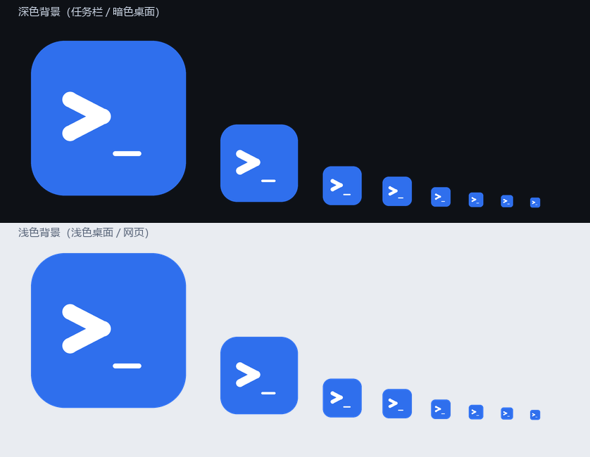
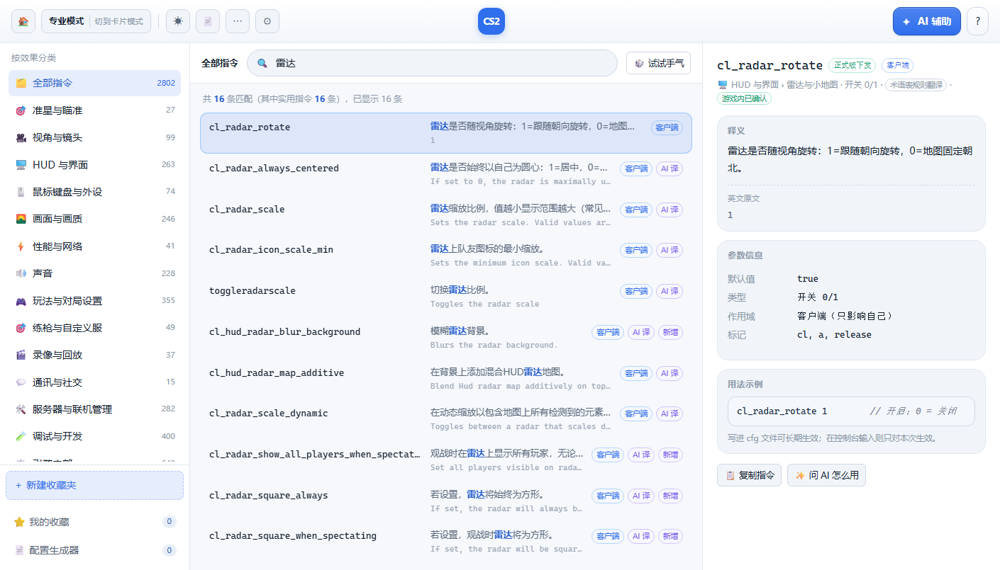
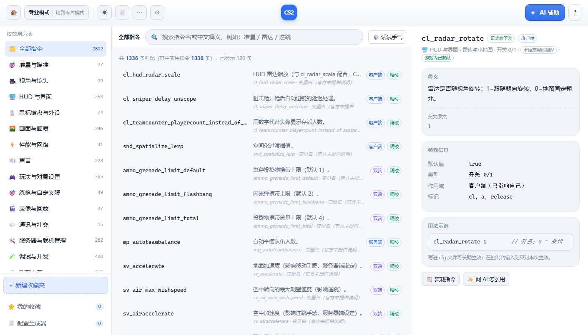
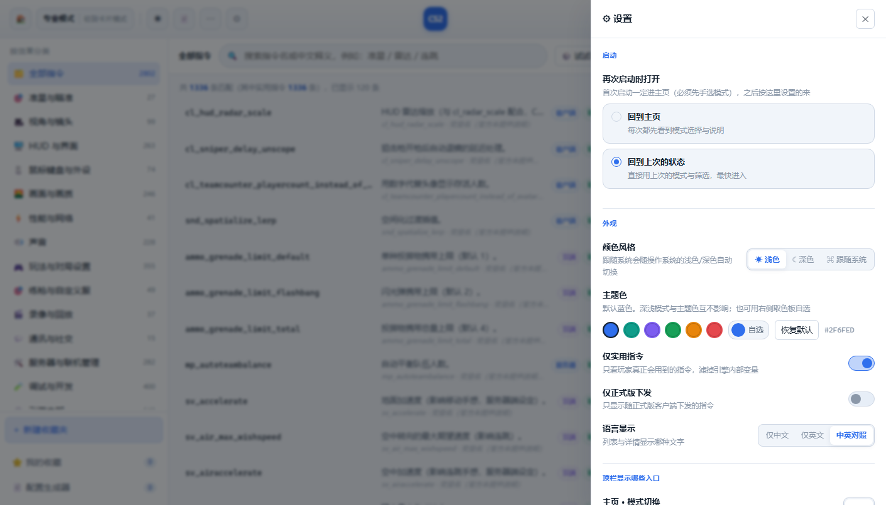

# CS2 控制台指令查询中心

给中文玩家用的 **CS2（Counter-Strike 2）控制台指令查询工具**：全量指令库 + 中文释义 + 按效果分类 + 参数方案 + AI 帮你把「想要的游戏效果」翻成具体指令和 `.cfg`。

一个**本地程序**，不修改游戏文件。










> 需要一段可直接引用的中英对照介绍？见 [docs/INTRO.md](docs/INTRO.md)。

---

## 一分钟上手

### 桌面版（推荐）

从 [Releases](../../releases) 下载，二选一：

| 文件 | 适合谁 |
|---|---|
| `CS2ConsoleHub-x.y.z-Portable.exe` | **单个 exe，双击即用**，免安装 |
| `CS2ConsoleHub-x.y.z-Setup.exe` | 可选安装目录，自动建快捷方式，可正常卸载 |

**无需 Python 或任何运行时。** 首次运行若提示「Windows 已保护你的电脑」，点「更多信息 → 仍要运行」（未做代码签名）。

### 从源码跑

```powershell
npm install
npm start            # 开发模式启动（Electron）
```

或者只跑网页版（不用 Node 依赖，只要有 Python）：

```powershell
.\start.cmd          # 启动本地服务并打开浏览器 http://127.0.0.1:8788/
```

> 完全不装任何东西也行：直接双击 **`index.html`** —— 离线浏览、搜索、收藏夹、参数方案、配置生成全部可用，
> 只有「AI 问答 / 翻译」需要本地服务（要转发请求）。

### 三步用起来

1. 左侧按效果分类点开，或直接在搜索框输入中文（「雷达 全图」「连跳」「准星 绿色」）。
2. 满意就**复制指令**，或加进收藏夹、调好数值存成**参数方案**。
3. 要自然语言提问，点 **✨ AI 辅助**，先在 **⚙ 接口设置** 里填一个 API Key。

---

## 功能

### 查指令

- 指令库收录 **2802 条** cvar / 指令，**全部**已在游戏本体里核对存在。
- 其中 **675 条**是控制台命令（`getpos` / `god` / `noclip` / `give` / `slot1` …），**1253 条**为正式版客户端下发。
- **15 个一级分类 × 66 个子分类**，按**玩家意图**组织而不是字母表：
  准星与瞄准 · 视角与镜头 · HUD 与界面 · 鼠标键盘与外设 · 画面与画质 · 性能与网络 · 声音 · 玩法与对局设置 · 练枪与自定义服 · 录像与回放 · 通讯与社交 · 服务器与联机管理 · 调试与开发 · 引擎内部 · 实用工具指令
- 搜索同时匹配**指令名、中文释义、英文原文**，按相关度排序，支持 `cl_` / `sv_` 前缀与多关键词（空格分隔）。
  中文没有空格分词，所以长句会退化为「二元字组覆盖率 + 同义词桥接」：
  搜「随地安放炸弹」能直接命中 `mp_plant_c4_anywhere`；短词（「雷达」）仍走精确匹配，不会被放宽。
- 每条详情给：中文释义、英文原文、默认值、类型、作用域、官方标记、**用法示例**、风险提示。
- **中文释义覆盖 100%**：精校 29 条 · AI 译 1809 条 · 术语表规则译 184 条 · 其余由变量名语义推断；
  723 条附带「名字语义拆解」。无信息可给的会明确写「官方未提供说明」并提示用 `help <名字>` 自查，**不硬造释义**。

### 显示与操作

- **语言显示**三选一：仅中文 / 仅英文 / 中英对照（设置内切换，记在本地）。
- **两种界面模式**：卡片模式（适合浏览）与专业模式（表格，适合批量操作），随窗口宽度自适应列数。
- 选中条目即时看详情；**📋 复制指令** 一键复制纯指令（不含注释）。
- **🎲 试试手气**：随机跳一条指令来学。

### 收藏夹与参数方案

- **收藏夹**：多收藏夹管理，支持**空收藏夹**、重命名、删除、导出 JSON、存为指令集。
- 侧栏点收藏夹旁的 **＋ 添加** 进入添加模式，卡片上点任意位置即可勾选，底部常驻条实时显示条数与目标夹。
- **参数设置模式**：点 **⚙ 参数设置**，每条指令后出现输入框；鼠标悬停在指令上显示释义作为参数提示，移开即隐。
- **保存方案**：把当前参数存为「**编号（一 / 二 / 三…）+ 自定义注释**」的方案，保存在本地，随时读取套用。
- **指令输出**：在收藏夹专栏下方生成文本框，输出**不带注释**、可直接粘进控制台的指令族。
- **导出 cfg**：方案一键导出为 `.cfg`（设置里选方式）——
  - *直接放进游戏目录*：写进 `<游戏目录>\game\csgo\cfg\`，控制台 `exec 文件名` 即生效
  - *生成到指定位置*：走保存对话框，你自己拖进游戏文件夹

### AI 辅助

先用中文说需求，程序会**先从本地 2802 条库里检索出最相关的几十条指令**作为上下文，再交给模型，避免它凭空编造指令。四种模式：

| 模式 | 用途 |
|---|---|
| ① 给需求 → 出指令方案 | 「准星改成绿色小十字、静态不扩散」→ 指令表 + 推荐值 + cfg 代码块 + 注意事项 |
| ② 解释某条指令 | 作用、取值范围、默认值、推荐设置、常见坑 |
| ③ 生成完整 cfg 配置 | 直接产出可保存为 `.cfg` 的完整内容 |
| ④ 排查问题 | 「游戏卡顿 / 声音方向不对」→ 可能原因 + 相关指令 + 排查步骤 |

支持任何 **OpenAI 兼容**接口，内置一键预设：DeepSeek · OpenAI · 通义千问 · 智谱 GLM · 本地 Ollama。

> **推理型模型注意**：`deepseek-reasoner` / `deepseek-v4-pro` 这类模型会把输出预算先用在「思考」上，
> `max_tokens` 给小了会导致正文为空。**这不是 Key 或余额的问题** —— 程序会自动识别这种情形并升档重试，
> 也会明确告诉你「预算被推理吃光了」。非推理模型（如 `deepseek-chat`）不受影响。

---

## 数据来源

指令库以**游戏自身 `cvarlist` 的完整导出**为权威来源（VConsole2 会话日志，2802 条 convars/concommands）：
权限标记、官方英文说明、是否命令均以它为准。上游社区仓库仅用于补全游戏未打印的字段。

**只保留在游戏本体里确认存在的指令。** 此前仅上游社区指令表收录、无法在游戏内核对的 2621 条已全部剔除，
因此界面上不再有「待游戏内确认」这一状态。遇到「未知指令」提示时，以游戏内 `help <指令名>` 为准。

- 数据更新截止：**2026 年 9 月 25 日**
- 指令库版本：`2026.10.14`

---

## 目录结构

```
cs2-console-hub/
├─ index.html              前端入口（单页）
├─ assets/
│  ├─ app.js               全部前端逻辑
│  ├─ style.css            布局与组件
│  ├─ theme.css            主题变量（浅色 / 深色 / 主题色）
│  ├─ db.js                离线内嵌指令库（与 data/commands.json 同步）
│  └─ icons/               图标（.ico 多尺寸 + 各尺寸 png + svg 源）
├─ data/
│  ├─ commands.json        指令库（权威数据）
│  ├─ db_meta.json         版本 / 统计
│  └─ zh_cache.json        AI 翻译缓存（越用越准）
├─ desktop/                Electron 桌面版
│  ├─ main.js              主进程：窗口、单实例、外链、下载、菜单
│  ├─ server.js            本地服务（Node 实现，替代 tools/server.py）
│  ├─ afterpack-icon.js    构建钩子：给 exe 嵌入图标
│  └─ verify_*.js / acceptance.js / test_server.js   自动化验证
├─ tools/                  构建与数据脚本（Python）
│  ├─ server.py            开发用本地服务
│  ├─ build_db.py          从原始导出重建指令库
│  ├─ import_cvar_dump.py  解析 cvarlist 导出
│  ├─ name_zh.py           从变量名推断中文释义
│  ├─ translate_db.py      AI / 机翻批量翻译
│  ├─ dev/                 e2e 与 mock 服务
│  └─ release/             发布打包脚本
├─ docs/                   文档（打包 / 发布说明 / 中英介绍 / 安全策略）
├─ package.json            Electron 构建配置
└─ start.cmd / start.ps1   网页版启动器
```

---

## 打包

```powershell
npm run dist:all              # 生成安装包 + 便携版
python tools\release\make_release.py   # 分装 release/（发布版 + 源码）
```

看到 `已嵌入应用图标` 表示图标处理成功。完整说明（含已知构建问题、验证脚本）见 [docs/packaging.md](docs/packaging.md)。

---

## 自己重建 / 二次开发

### 重建指令库

```powershell
python tools\build_db.py
python design\dev\sync_embedded_db.py   # 让离线内嵌库 assets/db.js 跟上
```

> **注意**：`assets/db.js` 是 `data/commands.json` 的序列化。若你只改了 `commands.json` 而没同步 `db.js`，
> **离线模式会放出旧条目**。改完务必跑一次同步脚本（它自带一致性自检）。

### 用本机游戏文件补全指令库

#### 路线 A（推荐）：把 `cvarlist` 的输出存下来

1. 游戏内按 `~` 打开控制台（设置 → 游戏 → 启用开发者控制台 = 是）。
2. 在控制台执行 `cvarlist`，或把 `tools/dump_commands.cfg` 放进游戏 cfg 目录后 `exec dump_commands`。
3. 用 VConsole2 或控制台日志把输出存成文本，然后：

```powershell
python tools\import_cvar_dump.py <导出文件>
```

#### 路线 B：扫描游戏二进制（不用玩游戏）

```powershell
python tools\scan_game.py       # 扫描游戏目录，提取候选指令名
python tools\find_gaps.py       # 与现有库比对，找出缺口
```

### 启动网页版

```powershell
python tools\server.py          # 默认 8788；设 CS2HUB_PORT 换端口
```

`tools/server.py` 只用标准库，**无需 `pip install`**。它也是 `start.cmd` 背后实际调用的东西。

### 桌面版与网页版的区别

| | 网页版 | 桌面版 |
|---|---|---|
| 本地服务 | `tools/server.py`（Python） | `desktop/server.js`（Node，内置） |
| 依赖 | 需要 Python | 无 |
| 端口 | 固定 8788 | **随机空闲端口**（避免冲突） |
| 离线 | 双击 `index.html` | `CS2HUB_NO_SERVER=1` 以 `file://` 加载 |

### 调试开关

| 环境变量 | 作用 |
|---|---|
| `CS2HUB_PORT` | 网页版服务端口 |
| `CS2HUB_DEBUG_PORT` | 让应用打开远程调试端口（自动化测试用） |
| `CS2HUB_NO_SERVER` | 桌面版不启服务，直接 `file://` 加载（验证离线可用） |

### 自动化验证

```powershell
npm run test:server       # 本地服务 32 项（接口 / 路径穿越 / AI 参数校验 / 缓存并集）
npm run verify:app        # 解包应用启动自检 15 项
npm run test:accept       # 目标验收 46 项（查指令 / 收藏夹 / 参数方案 / AI）
npm run test:offline      # 离线可用性 16 项
npm run test:exportcfg    # 导出 cfg 15 项
npm run test:app          # 在打包后的应用里跑完整 e2e
```

---

## 🛡 实验安全：怎么不「手滑」吃 VAC

**任何修改游戏文件本体的行为都可能导致 VAC 封禁。** 本工具不修改游戏文件，但你自己动手时要注意：

```powershell
# 出问题：让 Steam 把被改的文件下回来
#   Steam → CS2 → 属性 → 已安装文件 → 验证游戏文件的完整性
```

**建议**：把实验环境和受保护环境隔开，而不是「小心一点」——
改过游戏文件的客户端，最好只用 `-insecure` 玩本地 / 社区服 / demo，不要进官方竞技。

---

## 安全与隐私

- **不修改游戏文件本体**：不注入、不反编译、不替换资源、不改写 `game/core/*.vpk` 等游戏包。
- 唯一读取的是游戏自身输出的**控制台指令清单**（`cvarlist`），不涉及游戏资源文件。
- 不读写游戏进程内存，不注入代码，不加载第三方 DLL。
- **不承担任何 VAC 封禁责任。**
- **不读取、不存储、不上传**任何 Steam 账号或登录凭据。
- 收藏夹、方案、设置与 AI 翻译缓存**全部保存在本机**，不上传。
- API Key 只存本机，请求经**本地服务**转发到你填写的接口，不写入任何文件。

完整条款见软件内「**设置 → 免责声明与安全使用规范**」。

---

## 注意事项

- **作弊类指令**（带 `cheat` 标记，如 `sv_cheats`、`noclip`、`sv_infinite_ammo`）只在 `sv_cheats 1` 的**本地 / 私人服务器 / 机器人服**有效；官方匹配服务器强制 `sv_cheats 0`。界面对这类指令会显示红色「风险」标记。
- `cl_` 开头的客户端指令只影响你自己的画面与输入；`sv_` / `mp_` 开头的是服务器端设定，只有在自建服或本地才有权限修改。
- 本工具**只读**游戏数据，只写自己的 `data/`、`docs/` 与（在你开启自动导出时）游戏 `cfg` 目录里的 `.cfg`。

---

## 开源免费

**本软件开源免费，任何收费倒卖行为均为诈骗。**

作者从未授权任何第三方以本软件名义收费。项目不含付费解锁内容、会员体系或广告。
请只从本仓库的 Releases 或作者认可的渠道获取。

### 许可证

Copyright (C) 2026 SongYes

本项目以 **GNU 通用公共许可证第 3 版（GPL-3.0-only）** 发布，完整法条见 [LICENSE](LICENSE)，
版权声明与附加说明见 [NOTICE](NOTICE)。

你可以自由地使用、修改、再发布本项目，**包括商用**；但按 GPL 的传染性要求：

- **再发布的衍生作品必须同样以 GPL v3 开源**，不得改为闭源专有；
- 分发二进制时需一并提供对应源码（本仓库即是）；
- 必须保留版权声明与许可证全文，并标注你做过修改。

软件内「设置 → 关于本软件」也标注了许可证与版权信息。

## 联系

- 邮箱：songyuanuwu@gmail.com
- GitHub：<https://github.com/SongYes>
- B 站：<https://space.bilibili.com/1214830446>
